# StyleSupply — Route Map

Page routes and how they interconnect. Arrows show navigation (Link, router.push, redirect).

```mermaid
flowchart TD

  %% ── Entry ──────────────────────────────────────────────
  LANDING["/ (landing)"]
  RA["/request-access"]
  CS["/coming-soon"]

  %% ── Auth ───────────────────────────────────────────────
  LOGIN["/login"]
  SIGNUP["/signup"]
  FP["/forgot-password"]

  %% ── Core ───────────────────────────────────────────────
  HOME["/home"]
  PRODUCTS["/products"]
  PRODUCT_ID["/products/[id]"]
  PRODUCT_REVIEWS["/products/[id]/reviews"]
  BRANDS["/brands"]
  BRAND_SLUG["/brands/[brand]"]
  COLLECTIONS["/collections"]
  COL_SLUG["/collections/[slug]"]

  %% ── Wishlist ────────────────────────────────────────────
  WISHLIST["/wishlist"]
  WISHLIST_COL["/wishlist/[collectionId]"]

  %% ── Box flow ────────────────────────────────────────────
  BOX_MYBOX["/box/my-box"]
  BOX_CONFIRM["/box/confirm"]
  BOX_DELIVERY["/box/delivery"]
  BOX_SESSION["/box/session"]
  BOX_PAYMENT["/box/payment"]
  BOX_RETURNS["/box/returns"]

  %% ── Accounts ────────────────────────────────────────────
  ACCOUNTS["/accounts"]
  ACC_MEMBERSHIP["/accounts/membership"]
  ACC_MEMBERSHIP_MANAGE["/accounts/membership/manage"]
  ACC_ORDERS["/accounts/orders"]
  ACC_REVIEWS["/accounts/reviews"]
  ACC_WARDROBE["/accounts/wardrobe"]
  ACC_WARDROBE_REVIEW["/accounts/wardrobe/review"]
  ACC_SETTINGS["/accounts/settings"]
  ACC_PROFILE["/accounts/settings/profile"]
  ACC_PASSWORD["/accounts/settings/change-password"]
  ACC_LOGOUT["/accounts/settings/logout"]
  ACC_HELP["/accounts/help"]

  %% ── Static public ───────────────────────────────────────
  HIW["/howitworks"]
  FAQ["/faq"]
  ABOUT["/about"]
  LEGAL["/legal"]
  SITEMAP["/sitemap"]

  %% ════════════════════════════════════════════════════════
  %% MIDDLEWARE RULES (dashed = automatic redirect)
  %% ════════════════════════════════════════════════════════

  LANDING -. "logged in → redirect" .-> HOME
  LOGIN -. "logged in → redirect" .-> HOME
  SIGNUP -. "logged in → redirect" .-> HOME
  FP -. "logged in → redirect" .-> HOME

  HOME -. "unauthenticated → redirect" .-> LOGIN
  ACCOUNTS -. "unauthenticated → redirect" .-> LOGIN
  BOX_MYBOX -. "unauthenticated → redirect" .-> LOGIN
  WISHLIST -. "unauthenticated → redirect" .-> LOGIN

  %% ════════════════════════════════════════════════════════
  %% PAGE REDIRECTS
  %% ════════════════════════════════════════════════════════

  ACCOUNTS -- "redirect()" --> ACC_MEMBERSHIP

  %% ════════════════════════════════════════════════════════
  %% AUTH FLOW
  %% ════════════════════════════════════════════════════════

  LANDING --> LOGIN
  LANDING --> SIGNUP
  LOGIN --> FP
  FP --> LOGIN
  SIGNUP --> LOGIN
  LOGIN -- "post-login" --> HOME
  SIGNUP -- "post-signup" --> LANDING
  LOGIN -- "close ×" --> LANDING
  SIGNUP -- "close ×" --> LANDING
  FP -- "close ×" --> LANDING

  %% ════════════════════════════════════════════════════════
  %% BOX FLOW
  %% ════════════════════════════════════════════════════════

  BOX_MYBOX -- "Build & Continue" --> BOX_CONFIRM
  BOX_CONFIRM -- "Edit" --> BOX_MYBOX
  BOX_CONFIRM -- "Confirmed" --> BOX_DELIVERY
  BOX_DELIVERY -- "Delivery confirmed" --> BOX_SESSION
  BOX_SESSION -- "?stage=shopIntention" --> BOX_SESSION
  BOX_SESSION -- "Shop intention →" --> BOX_PAYMENT
  BOX_SESSION --> BOX_RETURNS

  %% ════════════════════════════════════════════════════════
  %% BROWSING
  %% ════════════════════════════════════════════════════════

  BRANDS --> BRAND_SLUG
  BRAND_SLUG --> PRODUCT_ID
  COLLECTIONS --> COL_SLUG
  PRODUCTS --> PRODUCT_ID
  PRODUCT_ID --> PRODUCT_REVIEWS
  PRODUCT_ID -- "no product → Browse All" --> PRODUCTS

  %% ════════════════════════════════════════════════════════
  %% WISHLIST
  %% ════════════════════════════════════════════════════════

  WISHLIST --> WISHLIST_COL
  WISHLIST -- "empty → CTA" --> COLLECTIONS
  WISHLIST -- "empty → CTA" --> PRODUCTS
  WISHLIST_COL -- "empty → CTA" --> COLLECTIONS
  WISHLIST_COL -- "empty → CTA" --> PRODUCTS

  %% ════════════════════════════════════════════════════════
  %% ACCOUNTS
  %% ════════════════════════════════════════════════════════

  ACC_MEMBERSHIP --> ACC_MEMBERSHIP_MANAGE
  ACC_SETTINGS --> ACC_PROFILE
  ACC_SETTINGS --> ACC_PASSWORD
  ACC_SETTINGS --> ACC_LOGOUT
  ACC_WARDROBE --> ACC_WARDROBE_REVIEW

  %% ════════════════════════════════════════════════════════
  %% REQUEST ACCESS
  %% ════════════════════════════════════════════════════════

  RA -- "confirmation CTA" --> LANDING

  %% ════════════════════════════════════════════════════════
  %% STYLES
  %% ════════════════════════════════════════════════════════

  classDef entry    fill:#7A021D,color:#fff,stroke:#2C0505
  classDef auth     fill:#2C0505,color:#fff,stroke:#7A021D
  classDef box      fill:#4a1a1a,color:#fff,stroke:#7A021D
  classDef accounts fill:#1a1a2e,color:#fff,stroke:#7A021D
  classDef browse   fill:#1a2e1a,color:#fff,stroke:#7A021D
  classDef static   fill:#F2F2F2,color:#2C0505,stroke:#ccc

  class LANDING,RA,CS entry
  class LOGIN,SIGNUP,FP auth
  class HOME,PRODUCTS,PRODUCT_ID,PRODUCT_REVIEWS,BRANDS,BRAND_SLUG,COLLECTIONS,COL_SLUG,WISHLIST,WISHLIST_COL browse
  class BOX_MYBOX,BOX_CONFIRM,BOX_DELIVERY,BOX_SESSION,BOX_PAYMENT,BOX_RETURNS box
  class ACCOUNTS,ACC_MEMBERSHIP,ACC_MEMBERSHIP_MANAGE,ACC_ORDERS,ACC_REVIEWS,ACC_WARDROBE,ACC_WARDROBE_REVIEW,ACC_SETTINGS,ACC_PROFILE,ACC_PASSWORD,ACC_LOGOUT,ACC_HELP accounts
  class HIW,FAQ,ABOUT,LEGAL,SITEMAP static
```

## Legend

| Color | Group |
|-------|-------|
| Red | Entry / prelaunch |
| Dark brown | Auth pages |
| Green | Browse / products / wishlist |
| Dark red | Box rental flow |
| Dark blue | Accounts |
| Light grey | Static public pages |

**Solid arrows** — explicit navigation (Link, router.push)
**Dashed arrows** — automatic middleware redirects (auth guard / logged-in guard)
